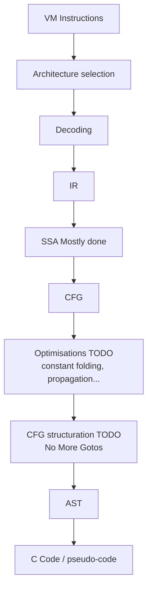

# Mini-Decompiler

ccg est un projet de mini-decompilateur pour custom ISA (peut-être Intel dans le futur)

Pour l'instant, ce décompilateur n'est pas fini.

> **Note :** It assumes as input an assembler code file from a disassembler that already converted binary opcodes to mnemonic representation and added location labels for jumps.

### Pipeline Architecture

TODO:
* Arenas

Ressources:
*   **[A Simple, Fast Dominance Algorithm](https://c9x.me/compile/bib/quickdom.pdf)**  
    *Keith D. Cooper, Timothy J. Harvey, and Ken Kennedy.*  
    Software: Practice and Experience / Rice University, 2006.

*   **[No More Gotos: Decompilation Using Pattern-Independent Control-Flow Structuring and Semantics-Preserving Transformations](https://net.cs.uni-bonn.de/fileadmin/ag/martini/Staff/yakdan/dream_ndss2015.pdf)**  
    *Khaled Yakdan, Sebastian Eschweiler, Elmar Gerhards-Padilla, and Matthew Smith.*  
    NDSS Symposium (Network and Distributed System Security), 2015.

*   **[Efficiently Computing Static Single Assignment Form and the Control Dependence Graph](https://dl.acm.org/doi/pdf/10.1145/75277.75280)**  
    *Ron Cytron, Jeanne Ferrante, Barry K. Rosen, Mark N. Wegman, and F. Kenneth Zadeck.*  
    ACM Transactions on Programming Languages and Systems (TOPLAS), 1991.

*   **[Ghidra P-Code Reference Manual](https://ghidra.re/ghidra_docs/languages/html/pcodedescription.html)**  
    *National Security Agency (NSA).*  
    Documentation officielle de la représentation intermédiaire (IR) de Ghidra.
